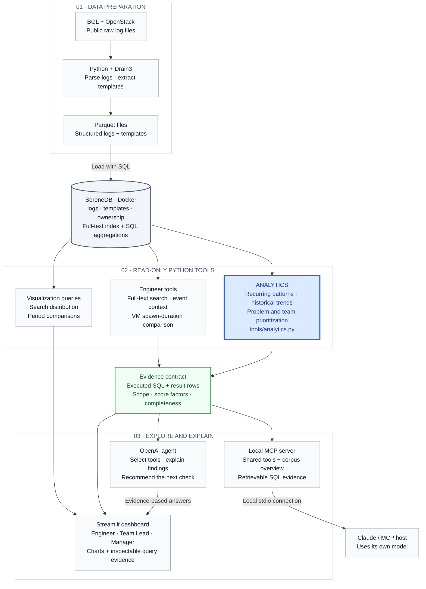

# Making Sense of Logs – schubKI National AI Hackathon 2026 (Challenge 04, SereneDB)

A prototype that turns BGL and OpenStack logs into evidence-based answers for
three roles: **Engineer** (investigate errors), **Team Lead** (understand recurring
problems), and **Manager** (prioritize investigations).

**Question → Evidence → Recommendation. SQL calculates; the AI explains.**

## System architecture

The pipeline prepares the logs once. At investigation time, SereneDB searches and
aggregates the selected data, and Python tools return bounded, verifiable evidence.
The same tools support direct dashboard exploration and model-led investigations.



**Analytics (blue)** turns the full filtered
log corpus into recurring-pattern counts, historical trends, and transparent
priority scores for Team Leads and Managers through `top_patterns`,
`pattern_trend`, and `priority_ranking`. See [Analytics documentation](ANALYTICS.md).

- **Prepare once:** parse raw files, extract templates, and load Parquet files
  plus the fictional component-to-team ownership mapping into SereneDB.
- **Explore directly:** the Streamlit dashboard calls read-only tools and chart
  queries without requiring a model API key.
- **Explain with AI:** the OpenAI agent selects tools and uses their results;
  it does not generate arbitrary SQL. The local MCP server offers a separate
  interface for an MCP host using its own model.
- **Inspect the evidence:** executed SQL, scope, counts, score factors and
  completeness metadata remain available for checking.

## Jury quick-start (Windows / PowerShell)

This submission includes a Streamlit web application with an integrated tool-calling
agent and a **local MCP server** exposing the same search and analytics tools.
For the separate Best MCP Server award, follow the **[Claude/MCP setup and demo](docs/MCP.md)**
(seven tools, three role prompts, bounded results and retrievable SQL evidence).
The MCP server needs no OpenAI key; the connected host supplies its own model.

Start with the [worked investigation](docs/worked-investigation.md), its
[executed SQL and actual agent answers](docs/evidence/worked-investigation.json),
and the [clean-checkout rehearsal](docs/clean-checkout-rehearsal.md).

### What the challenge supplies and what this repository adds

The challenge supplies the public BGL and OpenStack raw logs (Zenodo record
8196385) and SereneDB itself, but no shared database instance, loader, schema or
ownership table: teams build those themselves. This repository therefore contains
its own loader (`ingest/prepare.py` parses and templates the raw logs into Parquet;
`ingest/load.sql` loads them with `read_parquet`/`read_csv` and builds the
full-text index), the [schema](#data-schema) and a fictional
[ownership table](#fictional-team-ownership). The SereneDB instance in the steps
below is the official `serenedb/serenedb` Docker image started by `docker compose`;
an organiser-hosted instance can be used instead via `DB_DSN` (end of step 3).

### 1. Install from a clean checkout

Prerequisites: Git, Python **3.12**, Docker Desktop with Linux containers, internet
for package/data downloads, and enough disk space for raw logs, Parquet files and
database storage. No model key is needed to install or explore the charts.

```powershell
git clone https://github.com/EreDem/Hackathon.git
cd Hackathon
py -3.12 -m venv .venv
.\.venv\Scripts\python.exe -m pip install --upgrade pip
.\.venv\Scripts\python.exe -m pip install -r requirements.txt
.\.venv\Scripts\python.exe -m pip check
```

`requirements.txt` installs everything needed for preparation, database access,
the agent and the UI (it includes `requirements-agent.txt`). The optional MCP
server additionally needs `requirements-mcp.txt` (see [docs/MCP.md](docs/MCP.md)).
Versions used for the submission:

| Dependency | Tested version | Used for |
|---|---|---|
| Python | 3.12.10 and 3.12.14 | everything |
| Docker Desktop with image `serenedb/serenedb` | SereneDB 26.10.1 (reports PostgreSQL 18.3) | database on port 7890, bound to `127.0.0.1` |
| `pyarrow`, `drain3` | 26.0.0, 0.9.11 | `ingest/prepare.py`: parsing, Drain3 templates, Parquet |
| `psycopg[binary]`, `python-dotenv`, `pydantic` | 3.3.6, 1.2.4, 2.14.1 | database access, `.env` loading, tool input validation |
| `openai` | 2.54.0 | agent; needs your own `OPENAI_API_KEY`, model `OPENAI_MODEL=gpt-6.1-sol` |
| `streamlit`, `plotly`, `pandas` | 1.66.0, 7.1.0, 3.0.6 | UI and charts |
| `mcp` (`requirements-mcp.txt`) | 2.3.0 | optional MCP server |

### 2. Download and prepare both public datasets

```powershell
New-Item -ItemType Directory -Force data/BGL, data/OpenStack | Out-Null
curl.exe -L --fail -o data/BGL.zip "https://zenodo.org/records/8196385/files/BGL.zip?download=1"
curl.exe -L --fail -o data/OpenStack.tar.gz "https://zenodo.org/records/8196385/files/OpenStack.tar.gz?download=1"
.\.venv\Scripts\python.exe -c "import zipfile; zipfile.ZipFile('data/BGL.zip').extractall('data/BGL')"
.\.venv\Scripts\python.exe -c "import tarfile; tarfile.open('data/OpenStack.tar.gz').extractall('data/OpenStack', filter='data')"
.\.venv\Scripts\python.exe ingest/prepare.py data/BGL/BGL.log "data/OpenStack/openstack_*.log"
```

The full run must load **4,747,963 BGL** and **207,820 OpenStack** lines. A
`--limit` sample is useful for development but does not reproduce the submission.

### 3. Load a fresh local SereneDB and configure the app

The following loader **recreates the challenge tables**. Run it on a fresh local
instance, not an existing database whose data you need to preserve. Keep the
repository in place: Docker mounts this directory at `/data`.

```powershell
docker compose up -d
docker exec serenedb psql -h 127.0.0.1 -p 7890 -U postgres -c "SELECT version();"
# If the database is still starting, retry SELECT version() before loading.
docker exec serenedb psql -h 127.0.0.1 -p 7890 -U postgres -v ON_ERROR_STOP=1 -f /data/ingest/load.sql
.\.venv\Scripts\python.exe ingest/configure_local.py
```

The setup script creates a password-protected `log_observatory` login with schema
usage and SELECT on `logs`, `templates` and `ownership`. Its generated connection
string is staged in ignored `.env.setup`, then moved to ignored `.env`; the
password is never printed. Existing configured credentials are preserved.
On later starts, keep `.env` and simply run
`docker compose up -d`. A table reload requires restoring its SELECT grants (see
below). No broad trust-authentication rule is needed.

Role creation and grants run in one transaction. If setup fails, the existing
`.env` stays intact and `.env.setup` retains the generated credentials. Before
retrying, check the local role without printing its password:

```powershell
docker exec serenedb psql -h 127.0.0.1 -p 7890 -U postgres -c "SELECT rolname FROM pg_roles WHERE rolname = 'log_observatory';"
```

If no role exists, fix the reported setup prerequisite, remove `.env.setup` and
retry. If this setup committed successfully but saving `.env` failed, replace
`.env` with `.env.setup`. Do not use that recovery file for a role that already
existed before setup. Keep both files private. The compatibility command
`python ingest/run_sql.py ingest/load.sql` uses the same Docker admin connection
and stops at the first SQL error.

**Using an organiser-provided instance instead:** skip the local Docker and login
steps, copy `.env.example` to `.env` once and set `DB_DSN` to the supplied
PostgreSQL-compatible connection string, for example
`DB_DSN=host=<host> port=<port> dbname=<database> user=<user> password=<password>`.
If you load the data there with `ingest/load.sql`, note that its `read_parquet`
and `read_csv` paths (`/data/out/*.parquet`, `/data/ingest/ownership.csv`) are
read **by the database server**: the files must exist at those paths on the
server, or the paths must be adjusted. Do not point the table-replacing loader at
unrelated data.

### 4. Start and try the three roles

```powershell
.\.venv\Scripts\python.exe -m streamlit run app.py --server.address 127.0.0.1
```

Open **http://127.0.0.1:8501** on the same machine. Select a role/dataset/team,
click **Apply scope**, then **Run prepared investigation**. Inspect **Query
evidence** and download the investigation JSON. If the port is occupied, add
`--server.port 8502` and open that port instead.

To demonstrate the AI workflow, set your own `OPENAI_API_KEY` in `.env`, retain
the configured `OPENAI_MODEL`, and restart Streamlit. Never commit or share that
file. Model requests incur usage and use a local $5 ledger; preserve
`.agent-usage.sqlite3`. Without a key, direct exploration works and chat is
disabled. This repository does not include a shared jury key or a hosted service.

Use these questions in the assistant after selecting the indicated scope:

| Role / scope | Question to try |
|---|---|
| Engineer / OpenStack / All teams | Why is VM `544fd51c-4edc-4780-baae-ba1d80a0acfc` unusual? Compare its spawn duration with the baseline, inspect context and recommend the next check. |
| Team Lead / BGL / HPC Kernel | Which problems recur across the historical period? Compare their frequency and observed node reach, inspect a trend and recommend what we should investigate first. |
| Manager / BGL / All teams | Compare `data TLB error interrupt` with `data storage interrupt`. Use full-text search and aggregation to explain which deserves attention first and what remains unknown. |

### 5. Verify independently

```powershell
.\.venv\Scripts\python.exe -m unittest discover -v
$env:ANALYTICS_TEST_DB = '1'
.\.venv\Scripts\python.exe -m unittest discover -v
.\.venv\Scripts\python.exe -m tests.check_analytics_real
.\.venv\Scripts\python.exe -m tests.check_ui_real
```

These checks do not call the model. `python -m tests.check_ui_real --live`
explicitly runs three paid agent questions. SQL test fixtures are read-only CTEs;
the production UI never imports synthetic fixtures. The optional MCP server has
its own protocol check (`python -m mcp_server.check` after installing
`requirements-mcp.txt`), see [docs/MCP.md](docs/MCP.md).

### Known limitations for judging

- Local single-user prototype: no authentication, hosted jury URL or MCP endpoint.
- Historical batch corpus: no upload workflow or automatic ingestion of new logs.
  After an intentional table reload, restore SELECT grants and reconnect in the UI.
- Coverage measures recorded logs, not uptime. Reach measures observed identifiers,
  not customers. Event approximations and priority scores are heuristics.
- BGL timezone labels were retained from ingestion and may not represent corrected UTC.
- The agent has bounded calls, context and budget. Failures and shortened evidence
  remain visible; a model answer alone does not validate a numerical claim.
- Dependencies use version ranges; the rehearsal records the versions actually
  installed. New package/image releases may require another rehearsal.
- Message templates come from Drain3, a heuristic. Its thresholds (BGL 0.4,
  OpenStack 0.9) were tuned on 2,000-line Loghub samples (97 % correct grouping
  for BGL) before later masking fixes; the full corpus has no reference labelling.
  As a plausibility check, 90 % of BGL alert lines fall into the main template of
  their alert category.
- OpenStack tracebacks are logged as one row per line, each with its own template
  (24 rows for the cache-manager error). Events are approximated by `(pid, ts)`.
- Tested only on Windows/PowerShell against SereneDB 26.10.1; the Docker image tag
  is not pinned. SereneDB's server-side parameter binding failed for some
  parameter combinations, so all tools bind parameters client-side
  (`psycopg.ClientCursor`). Locally use `127.0.0.1`, not `localhost`: the port is
  bound to IPv4 only, and `localhost` may first wait 20–30 s on IPv6.

### Agent tool contract

The agent and the MCP server expose the same fixed read-only tools; neither
generates SQL. Inputs are validated by strict schemas in `agent/toolkit.py`
before any database access: unknown fields are rejected and types are not
coerced. Shared inputs:

- `dataset`: `"BGL"`, `"OpenStack"` or null (both).
- `team`: exact team name from the [ownership table](#fictional-team-ownership)
  (1–120 characters) or null.
- `von` / `bis`: optional ISO 8601 timestamps with `von` ≤ `bis`. The data is
  historical (BGL 2005-06-03 to 2006-01-04, OpenStack 2017-05-14 to 2017-05-17);
  never use today's date.

Every tool returns the same envelope: `sql` (the executed SQL with bound values),
`zeilen` (number of returned rows), `daten` (the rows), `meta` (applied filters,
`limit`, `gekuerzt` = more rows exist, scope and counting notes) and, where
applicable, `truncated` and `belege` (supporting queries with their own SQL).
A failed supporting query is reported as a warning, never as zero matches.

| Tool | Accepted inputs (default) | Returned data |
|---|---|---|
| `search_logs` | `query`: text, 1–500 characters (required); `modus`: `phrase` \| `all` \| `any` (`phrase`); `level`: list of `DEBUG`, `INFO`, `WARN`, `ERROR`, `FATAL`; `dataset`, `team`, `von`, `bis`; `limit`: 1–50 (20) | Matching log rows (`id`, `ts`, `dataset`, `level`, `component`, `service`, `team`, `template_id`, `node`, `instance_id`, `request_id`, `alert`, `message`); `gesamt_treffer` = all matching lines, `suchmodus` = effective mode, `muster_zusammenfassung` = matches per template |
| `get_context` | `log_id`: positive log ID, VM UUID or `req-` UUID (required); `fenster_sek`: 1–3600 (600); `limit`: 1–100 (50) | Anchor plus context rows (columns as above plus `pid`). BGL: same midplane within ±`fenster_sek`, plus `ausbruch_analyse` (same template on all nodes in the window). OpenStack: VM or request lifecycle (unlinked rows: same component within the window) plus every row of the same `(pid, ts)` event, e.g. a multi-line traceback (`meta.ereignis`); VM anchors add `requests_der_vm` and `request_verlauf`. `meta.scope` names the rule used |
| `vm_dauer` | `instance_id`: VM UUID (optional); `limit`: 1–20 (5) | Slowest OpenStack spawn observations (`instance_id`, `sek`, `platz`, `median_sek`, `min_sek`, `max_sek`, `schnitt_sek`, `gesamt_vms`, `log_id`, `ts`, `request_id`); `gesuchte_vm` = the selected VM's observation and rank. Always uses the full OpenStack corpus |
| `top_patterns` | `team`, `dataset`, `von`, `bis`; `limit`: 1–30 (10). Levels are fixed: BGL ERROR/FATAL, OpenStack also WARN | Per template: `n` (lines), `ereignisse` (approximate events), `alerts`, reach `knoten` / `vms` / `requests`, `erstmals`, `zuletzt`, `example_log_id`, `problem_template_ids`, `logzeilen_passend_gesamt`; `meta.bereich` holds the full-scope totals |
| `pattern_trend` | `template_id` (`BGL-…` / `OS-…`) and/or `team`, at least one required; `dataset`, `von`, `bis`; `intervall`: `1 hour` \| `1 day` \| `1 week` (`1 day`) | Per time bucket: `zeit`, `n`, `ereignisse`, `alerts`, `beobachtete_logs`, `datenluecke` (no logs recorded in that bucket) |
| `priority_ranking` | `group_by`: `template` \| `team` (`template`); `dataset`, `team`, `von`, `bis`; `limit`: 1–100 (20) | Per group: `rang`, `score` and every factor (`haeufigkeit_norm`, `schweregrad`, `reichweite_norm` with `reichweite_typ`, `trendfaktor` from `erste_haelfte` / `zweite_haelfte`, `alertfaktor`), `vergleichsgruppe`, `status`; `meta.score_formel`; unscored groups are counted in `nicht_bewertbar_gesamt` |
| `corpus_overview` (MCP only) | none | Per dataset and team: `logzeilen_gesamt`, `erstmals`, `zuletzt` |

The limits above apply to the agent and MCP interfaces. The Streamlit UI calls the
same Python functions directly with its own validated limits;
`search_distribution` and `period_comparison` reuse the same query conventions
for its charts.

## OpenAI agent development

The agent uses the official OpenAI Python SDK and the Responses API.
The interface used by the UI is `antworte(rolle, team, frage, verlauf)`,
returning `{"text": str, "belege": list}`; `meta` also reports status and usage.
All three roles and all six search and analytics tools are connected.
Real investigations require a running local SereneDB loaded with both datasets.
For startup, tests and interfaces, see [agent/README.md](agent/README.md).

**Not needed for judging.** Skip the following if you followed the quick-start:
it would replace the quick-start's Python 3.12 environment in `.venv` and install
only the agent and database packages.

For agent-only development on Windows with Python 3.13 already installed:

```powershell
py -3.13 -m venv .venv
.\.venv\Scripts\python.exe -m pip install -r requirements-agent.txt
# Only create .env if it does not already exist:
if (-not (Test-Path .env)) { Copy-Item .env.example .env }
```

Set your own `OPENAI_API_KEY` in the local `.env` file. Initial tests use
`OPENAI_MODEL=gpt-6.1-sol`. Never copy keys into the repository or chat messages.
Installation alone makes no API calls. This smaller installation includes only
agent/database packages. Data ingestion and the UI require the full dependencies
from the quick-start; note the Python 3.13 Drain3 instructions in `requirements.txt`.

## Setup

Use the jury quick-start above for the complete installation and load workflow.

SereneDB documentation MCP for coding assistants: `claude mcp add --transport http serenedb-docs https://api.serenedb.com/mcp`

## Log Observatory UI

From the repository root, after installing requirements and loading the database:

```powershell
# Uses Python 3.11/3.12 and Streamlit 1.66+; theme loads from .streamlit/config.toml
# The local setup script already created .env; preserve it.
.\.venv\Scripts\python.exe -m streamlit run app.py --server.address 127.0.0.1
```

Open http://127.0.0.1:8501. Direct exploration needs only SereneDB; no model API
key is required. The application loads `.env` before importing database tools.
An unavailable database shows setup guidance and a reconnect button, not demo numbers.

- **Engineer:** full-text search, selectable log rows, an anchor-centered event timeline,
  message details, related request evidence and an OpenStack spawn-duration comparison.
- **Team Lead:** recurring-pattern bars and a selectable pattern trend, with log-line /
  approximate-event measures and visible observation gaps.
- **Manager:** priority bars, frequency-versus-observed-reach bubbles, score factors,
  unscored problems and a drill-down into supporting logs. Ranks stay within their
  dataset/reach comparison group; they are not a global impact ranking.
- **Evidence:** executed SQL, inputs, result tables, scope metadata, partial-result /
  truncation notices and downloadable JSON. Supporting queries remain accessible.

Select a role/dataset, choose a historical range/team, then **Apply scope**.
**Run prepared investigation** queries the active scope. BGL search starts with
`data TLB error interrupt`; the other roles load patterns or priorities. Changing
scope or role clears old results and conversations. Results live in session state;
zooming charts or changing display measures does not re-query the database.
Use **Reconnect / refresh data** after reloading the corpus.

Context deliberately broadens beyond the active dashboard scope: BGL uses the
anchor's midplane/time window, and OpenStack VM/request views cover their recorded
lifecycle. Spawn-duration comparisons use the entire OpenStack corpus. These
exceptions are disclosed beside the results. Log lines and `(pid, ts)` event
approximations are not confirmed incident counts. Scores are heuristics, not
measured customer impact. BGL timestamp conventions remain unchanged.

### Integrated OpenAI agent

`agent/agent.py` now implements the existing interface, extended with optional UI settings:

```python
def antworte(rolle: str, team: str | None, frage: str, verlauf: list,
             *, language="de", scope=None) -> dict:
    # rolle: "Engineer", "Team Lead", or "Manager"
    # verlauf: [{"role": "user" | "assistant", "content": "..."}, ...]
    return {"text": "English answer grounded in tools", "belege": [
        {"tool": "search_logs", "inputs": {"query": "..."},
         "result": {"sql": "executed SQL", "zeilen": 1, "daten": []}}
    ]}
```

The agent returns raw evidence with `beleg_id`, `tool`, `parameter`, `sql`, `daten`
and completeness metadata. The UI retains those fields, supporting queries,
status and usage, and accepts the wrapped example above for compatibility.
The UI requests `language="en"` and supplies the historical `scope` explicitly.
The agent enforces non-null scope filters on applicable tool calls. Context and
spawn comparisons disclose their broader scope. Existing CLI calls stay German.

Configure `OPENAI_API_KEY` in the ignored local `.env`. The UI checks readiness
without an API request and disables chat until configured. Calls use the configured
`OPENAI_MODEL`, the existing four-request/six-tool-call limits and the local $5
usage ledger; do not delete `.agent-usage.sqlite3`. Failed or incomplete agent
statuses preserve evidence and show English diagnostics instead of a successful
answer. The UI displays evidence IDs, model-view truncation, token usage and
estimated cost. Direct exploration remains available without a model key.

## Role-specific visual exploration

All views work without model calls. Use the action buttons to run SQL; chart
controls reuse session results. Changing the applied scope clears old evidence.

- **Engineer:** search-hit timeline across all matches, node/time (BGL) or
  component/time (OpenStack) heatmap for the top 20 resources, and a keyboard
  selector that opens supporting log context. Missing timestamps and identifiers
  are counted separately; observation gaps remain blank.
- **Team Lead:** ranked patterns, Pareto concentration using the full matching
  log-line denominator, and up to four leading patterns in shared-axis trends
  and a pattern/time heatmap. Log lines and approximate events remain distinct.
- **Manager:** explainable priority ranking and frequency/reach bubbles, team
  comparison dots within one reach unit, and two equal calendar periods showing
  matching lines, matches per 1,000 scoped lines, and observed calendar buckets.
  Coverage is recorded-log coverage, not uptime or customer impact.

Every query, including supplementary chart queries, is available in the evidence
panel and JSON download. Chart queries expose truncation; unknown rates/reach
remain unknown. Search maps use the search result's effective matching mode.

Run chart and interaction checks with `python -m unittest tests.test_visuals tests.test_ui`.
Set `ANALYTICS_TEST_DB=1` to include real SereneDB checks, then run
`python -m tests.check_ui_real` for all three roles against the loaded corpus.
This command makes no model calls unless `--live` is explicitly supplied.

## Data schema

| Table | Columns |
|---|---|
| `logs` | id, dataset, ts, level, level_raw, component, service, node, pid, request_id, instance_id, alert, message, template_id, source_file, parsed |
| `templates` | template_id, dataset, template, count, first_seen, last_seen, max_level, alerts, main_component, example_log_id |
| `ownership` | dataset, component, team |

- `template_id`: Drain3 message template, prefixed with `BGL-` or `OS-`.
- `alert`: BGL label; values other than `-` mark labeled anomalies in the source data.
- `request_id` / `instance_id`: link OpenStack lines belonging to the same request or VM.
- `node`: BGL node identifier, used with a time window to retrieve context.

## Fictional team ownership

The component-to-team mapping in [`ingest/ownership.csv`](ingest/ownership.csv)
lets Team Lead and Manager investigations group results by the responsible team.

| Team | Components |
|---|---|
| HPC Kernel | BGL: KERNEL |
| HPC Application Support | BGL: APP |
| HPC Control System | BGL: MMCS, BGLMASTER, CMCS |
| HPC Hardware & Interconnect | BGL: DISCOVERY, HARDWARE, LINKCARD, SERV_NET |
| HPC Operations | BGL: MONITOR |
| Cloud API | OpenStack: nova.osapi_compute.wsgi.server, nova.metadata.wsgi.server, nova.api.*, keystonemiddleware.auth_token |
| Cloud Compute | OpenStack: nova.compute.manager, nova.compute.claims, nova.compute.resource_tracker, oslo_service.periodic_task |
| Cloud Virtualization | OpenStack: nova.virt.libvirt.* |
| Cloud Scheduling | OpenStack: nova.scheduler.* |

## Project structure

```
ingest/   prepare.py, load.sql, run_sql.py, ownership.csv
tools/    Search, context, analytics and visualization queries
agent/    Role prompts and the OpenAI tool-calling loop
mcp_server/  Local stdio MCP server exposing shared tools and evidence
app.py    Streamlit user interface
ui.py     Charts and evidence presentation
data/     Raw datasets (not committed)
out/      Prepared files and local validation reports (not committed)
```

## Team

| # | Area | Person |
|---|---|---|
| 1 | Data preparation & loading | Eren |
| 2 | Search (Engineer) | Kirdar |
| 3 | Analytics (Team Lead & Manager) | Ghazal |
| 4 | Agent | Kardo |
| 5 | UI, Demo & Pitch | Omar |
